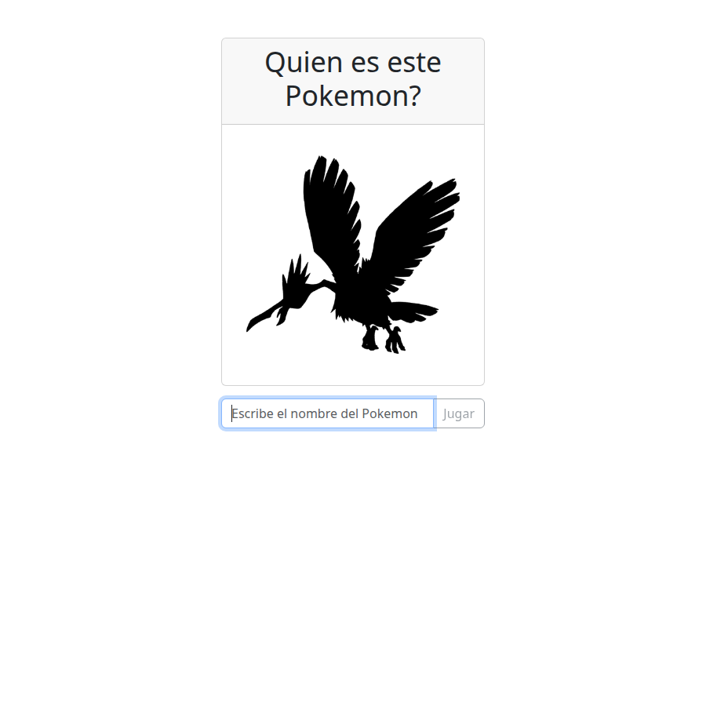
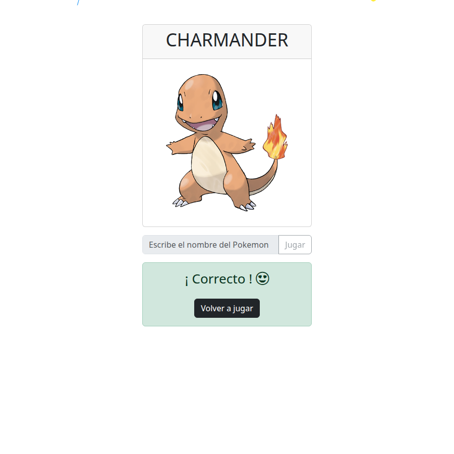
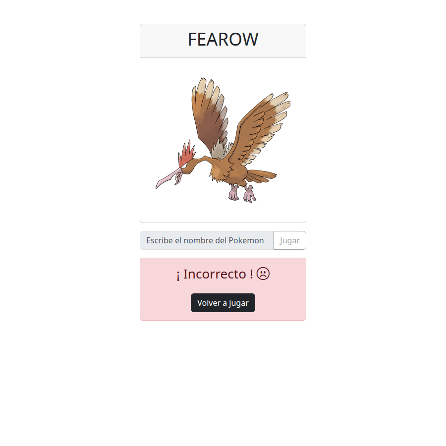

# ¿Quién es este Pokémon?

## Overview

Juego web de adivinanza inspirado en el clásico *“Who’s that Pokémon?”*. La aplicación muestra la silueta de un Pokémon aleatorio (de la primera generación) y el jugador debe escribir su nombre.

**Problema que resuelve:** practicar React moderno (hooks, tipado, servicios y componentes) con un flujo de juego completo: carga asíncrona, validación de respuesta, estados de acierto/error y feedback visual.

**Objetivo:** ofrecer una experiencia simple y jugable en el navegador, consumiendo datos reales de [PokéAPI](https://pokeapi.co/), con UI clara (Bootstrap) y una celebración con confetti cuando la respuesta es correcta.

## Tech Stack

| Tecnología | Uso en el proyecto |
| --- | --- |
| **React 19** | UI y estado del juego |
| **TypeScript** | Tipado de componentes, props, servicios e interfaces |
| **Vite 7** | Bundler y servidor de desarrollo |
| **Bootstrap 5.3** | Layout, formularios, alerts y spinner |
| **Bootstrap Icons** | Iconos en el feedback de resultado |
| **react-confetti** | Animación de confetti al acertar |
| **react-use** (`useWindowSize`) | Tamaño de ventana para el confetti a pantalla completa |
| **PokéAPI** | Fuente de datos de Pokémon (`https://pokeapi.co/api/v2/pokemon`) |
| **ESLint** + plugins React | Linting del código |
| **pnpm** | Gestor de paquetes (hay `pnpm-lock.yaml`) |

> Este proyecto **no** usa Angular, RxJS ni Tailwind. El stack real es React + TypeScript + Vite + Bootstrap.

## Key Features

- **Silueta oculta:** la imagen del Pokémon se muestra en negro (`brightness(0)`) hasta que el jugador responde.
- **Adivinanza por nombre:** formulario controlado con validación de campo vacío y deshabilitado tras jugar.
- **Validación tolerante:** comparación normalizada (minúsculas, trim, sin acentos ni caracteres especiales).
- **Pokémon aleatorio (Gen 1):** IDs del 1 al 151 vía PokéAPI, con artwork oficial.
- **Estados de juego:** `PLAYING`, `CORRECT` y `WRONG`, con mensajes de éxito/error.
- **Confetti al acertar:** `react-confetti` a tamaño de ventana cuando `gameStatus === 'CORRECT'`.
- **Loading y errores:** spinner mientras carga; alerta de Bootstrap si falla el fetch.
- **Volver a jugar:** botón que pide un nuevo Pokémon y reinicia el estado.

## Technical Concepts

### Custom hooks y estado del juego

La lógica de negocio (carga, validación y `gameStatus`) vive en un custom hook, no en los componentes de presentación.

**Implementation:** `src/hook/use-game-manager.ts`

### `useState` / `useEffect` / `useCallback`

- `useState` para Pokémon actual, loading, error y estado del juego.
- `useEffect` para cargar el primer Pokémon al montar.
- `useCallback` para estabilizar `loadNewPokemon` y `handlePokemonNameSubmit`.

**Implementation:** `src/hook/use-game-manager.ts`, `src/components/FormPokemon.tsx`

### Servicio asíncrono con `fetch`

El acceso a la API y la validación del nombre están encapsulados en un servicio exportado como objeto (`pokemnonService`).

**Implementation:** `src/services/pokemon.service.ts`

### Tipado con TypeScript

Interfaz `Pokemon` (`id`, `name`, `image`) y tipo derivado `GameStatusType` a partir de un objeto `as const`.

**Implementation:** `src/Types/pokemon.interface.ts`, `src/hook/use-game-manager.ts`

### Componentes presentacionales

UI separada por responsabilidad: mostrar silueta, formulario, resultado y spinner. Reciben props tipadas y no conocen PokéAPI.

**Implementation:** `src/components/DisplayPokemon.tsx`, `src/components/FormPokemon.tsx`, `src/components/ResultPkemon.tsx`, `src/components/Spinner.tsx`

### Utilidad pura

Generación de enteros aleatorios en un rango para elegir el ID del Pokémon.

**Implementation:** `src/lib/random-numbers.ts`

## Architecture

```
src/
├── App.tsx                 # Orquestación: hook + layout + confetti
├── main.tsx                # Entry point (Bootstrap, StrictMode)
├── components/             # UI reutilizable / presentacional
│   ├── DisplayPokemon.tsx
│   ├── FormPokemon.tsx
│   ├── ResultPkemon.tsx
│   └── Spinner.tsx
├── hook/
│   └── use-game-manager.ts # Estado y reglas del juego
├── services/
│   └── pokemon.service.ts  # Fetch a PokéAPI + validación de nombre
├── Types/
│   └── pokemon.interface.ts
└── lib/
    └── random-numbers.ts
```

**Separación de responsabilidades**

| Capa | Responsabilidad |
| --- | --- |
| `App` | Compone la pantalla, maneja error global y confetti |
| `useGameManager` | Estado del juego y casos de uso (cargar / validar) |
| `pokemon.service` | I/O externo y reglas de comparación de nombres |
| `components/*` | Render y UX local (formulario, alerts, spinner) |
| `lib` / `Types` | Utilidades e contratos de datos |

No hay routing, store global (Redux/Zustand) ni capa de DI: el flujo es lineal y suficiente para una sola pantalla de juego.

## Technical Decisions

1. **Custom hook en lugar de lógica en `App`**  
   Centraliza loading, error, Pokémon y `gameStatus` para que los componentes se mantengan enfocados en la UI.

2. **Servicio dedicado para PokéAPI**  
   Aísla `fetch`, mapeo a `Pokemon` y normalización del nombre; facilita cambiar la fuente de datos o la regla de validación sin tocar la UI.

3. **Bootstrap en lugar de CSS custom / Tailwind**  
   El proyecto usa clases de Bootstrap (cards, `input-group`, alerts, spinner) importadas en `main.tsx`; no hay hoja de estilos de diseño propia relevante (`index.css` está vacío).

4. **Confetti solo en acierto, sin reciclaje**  
   `recycle={false}` evita un loop infinito de partículas; el tamaño se toma de `useWindowSize` para cubrir el viewport.

5. **Normalización agresiva del nombre**  
   Permite variaciones tipográficas (mayúsculas, espacios, acentos) sin exigir coincidencia exacta con el string de la API.

6. **Límite a 151 Pokémon**  
   Enfoca el juego en la primera generación, acotando el espacio de adivinanza.

## Getting Started

### Requisitos

- Node.js (recomendado 18+)
- pnpm (el repo incluye `pnpm-lock.yaml`; también puedes usar `npm` si lo prefieres)

### Instalación

```bash
git clone https://github.com/ciroribba/react_level_4.git
cd react_level_4
pnpm install
```

### Variables de entorno

No se requieren. La URL de PokéAPI está definida en el servicio:

`src/services/pokemon.service.ts` → `https://pokeapi.co/api/v2/pokemon`

Necesitas conexión a internet para cargar Pokémon.

### Scripts disponibles

| Script | Comando | Descripción |
| --- | --- | --- |
| Desarrollo | `pnpm dev` | Servidor Vite con HMR |
| Build | `pnpm build` | `tsc -b` + build de producción |
| Preview | `pnpm preview` | Sirve el build localmente |
| Lint | `pnpm lint` | Ejecuta ESLint |

### Uso local

```bash
pnpm dev
```

Abre la URL que indique Vite (por defecto `http://localhost:5173`), mira la silueta, escribe el nombre del Pokémon y pulsa **Jugar**. Si aciertas verás confetti; en cualquier caso puedes pulsar **Volver a jugar**.

## Screenshots

Capturas generadas desde la app en local (`pnpm dev`):

### Jugando

Silueta oculta y formulario activo.



### Respuesta correcta

Nombre revelado, alert de éxito y confetti.



### Respuesta incorrecta

Alert de error y botón **Volver a jugar**.



Las imágenes viven en `docs/screenshots/`. Para regenerarlas, arranca el servidor de desarrollo y captura de nuevo esos tres estados.

## Live Demo

Todavía no hay una demo desplegada en este repositorio (no hay URL de Vercel, Netlify, GitHub Pages u otro hosting documentada). Para probarlo, usa `pnpm dev` en local.

---

Proyecto de **Ciro Zeballo Ribba** — práctica de React (nivel 4).
